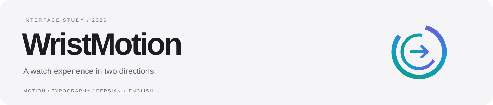
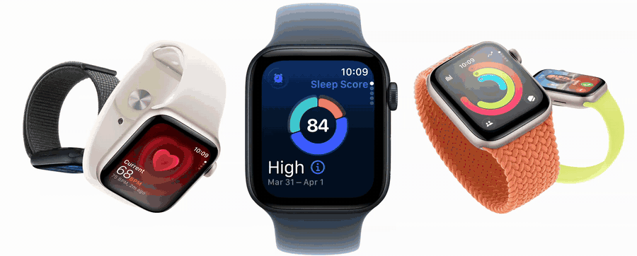
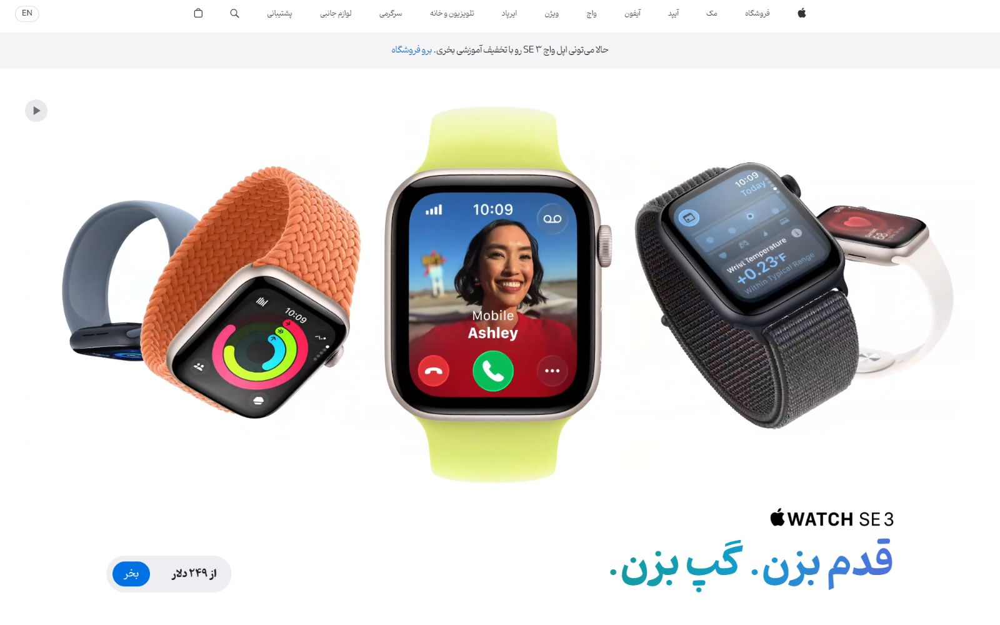
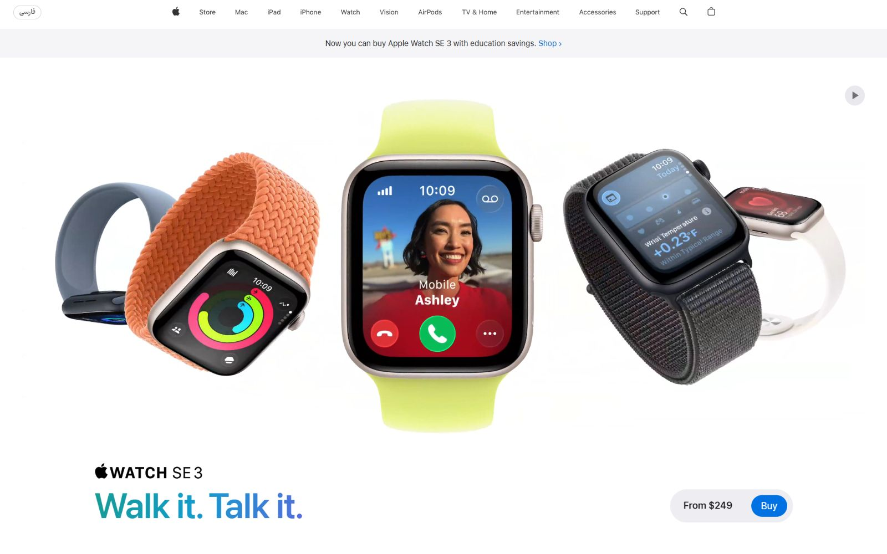
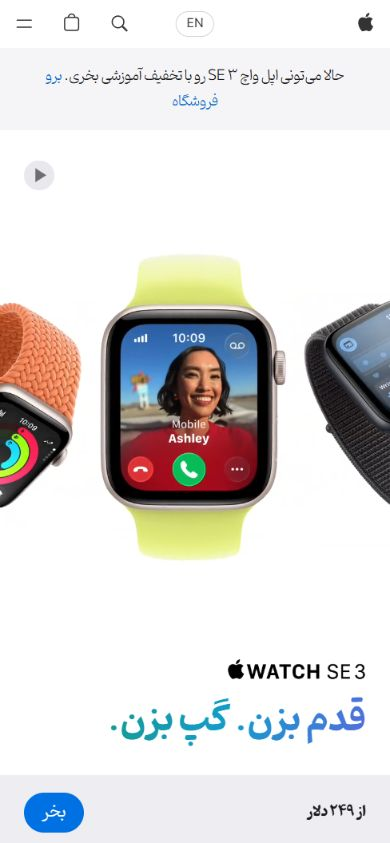
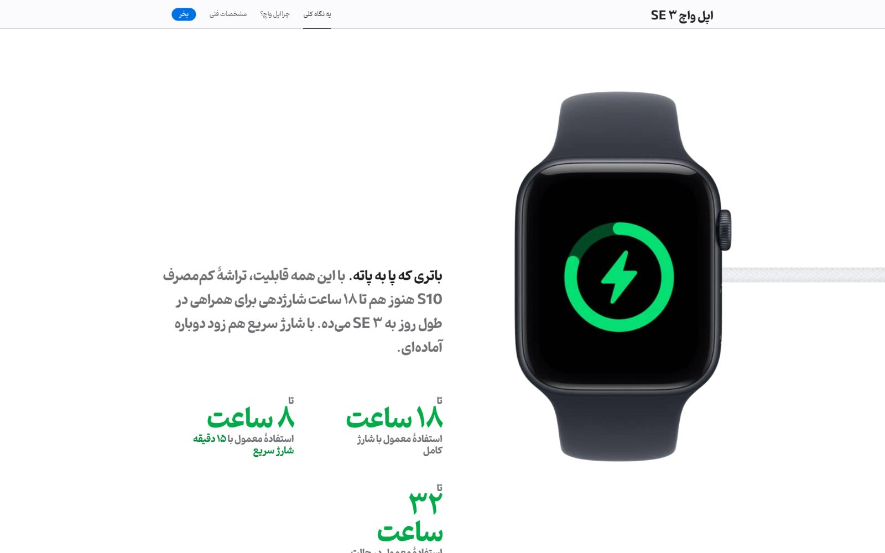
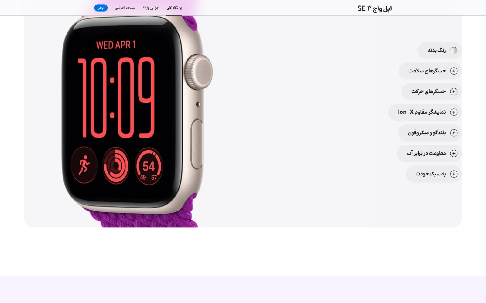

<p align="center">
  
</p>

<p align="center">
  
</p>

<p align="center">
  <strong>A bilingual product-page reconstruction, with Persian at its heart.</strong><br />
  Apple Watch SE 3 · Responsive motion · Pinar typography · Persian RTL / English LTR
</p>

<p align="center">
  <a href="docs/README.fa.md">فارسی</a> ·
  <a href="#the-experience">Explore the work</a> ·
  <a href="#run-locally">Run locally</a> ·
  <a href="QA.md">Verification notes</a> ·
  <a href="SOURCES.md">Source credits</a>
</p>

---

## The experience

WristMotion is a visual implementation study by [Sajjad Dehghan](https://github.com/sajjad-dehghan). It reconstructs an Apple Watch SE 3 reference and extends it into a Persian-first experience: conversational copy, local Pinar fonts, readable RTL layouts, and motion that stays aligned with the product.

The opening animation is a looping GIF of the retained hero film. The screenshots below come from the running implementation.

### Persian, by default



### The same product, another direction



<table>
  <tr>
    <td align="center"><strong>Made for small screens</strong></td>
    <td align="center"><strong>Direction-aware motion</strong></td>
  </tr>
  <tr>
    <td align="center" width="32%"></td>
    <td align="center" width="68%"></td>
  </tr>
</table>

### Explore the product



## What I worked on

- **Reference reconstruction.** Restored the older five-watch hero film, recreated its desktop proportions, gradient headline, pricing pill and playback controls.
- **Persian localization.** Authored 618 source-string translations or brand-name exceptions, including marketing copy, accessible labels and dynamic component text.
- **Typography and direction.** Added four local Pinar weights, Persian digits, RTL navigation and captions, while retaining English typography and LTR flow.
- **Motion details.** Corrected the RTL charger entry, mirrored the accessory without mirroring the watch face, and aligned image layers at mobile sizes.
- **Responsive delivery.** Packaged media locally, preserved the original galleries and product-detail components, and verified the implementation in the browser.

Apple's imagery, film and native component scripts are retained and adapted. My contribution is the reconstruction, localization, custom hero controls, directional styling and integration—not the creation of the original product assets.

## Interaction highlights

| Detail | Behavior |
| --- | --- |
| Hero film | Responsive media, play/pause, visibility-aware playback and reduced-motion support |
| Language control | Persian ↔ English; preserves query parameters and section fragments |
| Product exploration | Detail panels, finish selection and localized labels |
| Highlights | Selectable feature panels and native RTL gallery scrolling |
| Charging section | Cable enters from the right in Persian, clear of the copy |

## Run locally

**Node.js 20+** serves the committed site. No dependency installation or frontend build is needed.

```bash
git clone https://github.com/sajjad-dehghan/wrist-motion.git
cd wrist-motion
npm run dev
```

Open **http://127.0.0.1:4173/**.

| Route | Experience |
| --- | --- |
| `/` | Persian default, RTL, Pinar |
| `/en/` | English, LTR, SF Pro |
| `/?reference=1` | A paused hero frame for visual review; Play still works |

```bash
npm run check
```

The check verifies local resources, responsive video variants, locales, fonts and hosting configuration. Browser review covered desktop, tablet and mobile; see [QA.md](QA.md) for evidence and limits.

## Under the hood

```text
dist/                     Ready-to-serve website and local assets
  index.html              Persian default
  en/index.html           English version
  assets/recreation.*     Custom hero layout and playback
  assets/localization.*   Pinar, RTL styling and dynamic labels
src/                      Retained English source and editable Persian copy
scripts/                  Local server, static checks and locale generation
docs/media/               README animation and implementation screenshots
```

Edit `src/fa-copy.txt`, then run `python scripts/localize.py` with Python 3 and `lxml` to regenerate both locales. Visitors receive static translated HTML.

## Reference and attribution

The [Refero reference](https://styles.refero.design/style/569ba4c0-0431-44fb-92df-0dbea7f3e63d) establishes the first desktop viewport. Lower sections use the official Apple page captured during implementation; an exact historical match to unseen sections is not claimed.

Apple imagery, video, trademarks, SF Pro fonts and native components belong to their respective owners. Pinar comes from the project owner's supplied files. This independent portfolio study is not affiliated with Apple. Commerce and account links lead to Apple's official website.

[Source provenance](SOURCES.md) · [Verification details](QA.md) · [README media details](docs/media/README.md)
